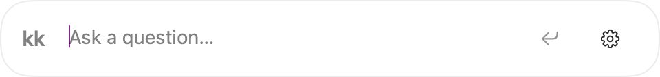
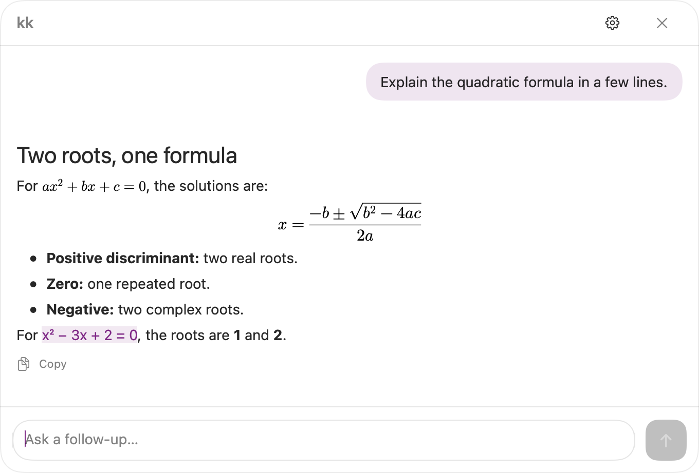
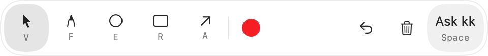
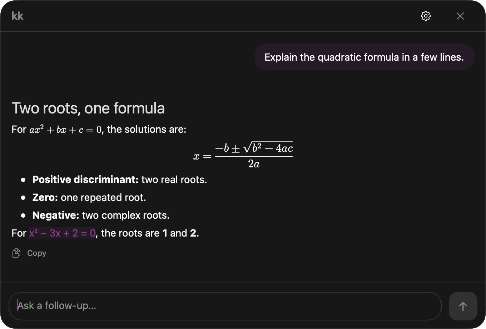

# kk

Native macOS screen-context Q&A.

Press ⌘⌥K (customizable in Settings), ask a question, and kk sends your prompt plus any attached screen image directly to an OpenAI-compatible model.

## Preview

Native app screenshots with sample content.







<details>
<summary>Dark appearance</summary>



</details>

## Download

Get the [v0.9.0 prerelease](https://github.com/imapotatoes11/kk/releases/tag/v0.9.0) for Apple Silicon and macOS 15 or later. The DMG contains `kk.app` and an Applications shortcut. A standalone app ZIP is also available.

This preview is ad-hoc signed and not notarized. It is not a Developer ID-signed distribution.

## Requirements

- macOS 15 or later
- Xcode current stable with Swift 6 support
- A vision-capable OpenAI-compatible Chat Completions endpoint

## Setup

Open `kk.xcodeproj` in Xcode and run the `kk` app target. The project resolves KeyboardShortcuts 3.x and MarkdownView 3.x through Swift Package Manager. `Package.swift` is also included for package-aware tooling and tests.

kk is a menu-bar utility and does not show a normal main window. Open Settings from the menu-bar item or the popup's gear button. Connection contains the endpoint, optional API key, and model; Shortcuts contains the global shortcut recorder and keyboard reference.

Drag the popup by its header and resize it from an edge or corner. Questions grow as text wraps, then scroll for longer prompts. Answers support Markdown (including code blocks and tables) and inline/display LaTeX using `$…$`, `$$…$$`, `\(…\)`, and `\[…\]`. Scroll up to pause automatic following; return to the bottom to resume. Each answer has a Copy action.

General includes opening size and position, snapping, popup material, always-on-top behavior, light/dark/system appearance, preset/system accents, answer text size, and optional model thinking. Full size defaults to a short 680-point-wide prompt; Compact defaults to a 480-point-wide launcher bar with kk, the editor, and settings. Each has a six-step width slider and reset control. Permission/recovery notices add only the height they need. The conversation grows smoothly to fit its content, up to 680 × 620 (or the selected opening width if wider). Its minimum width matches the selected bar width. Streaming updates are batched and do not restart an active resize animation. Long responses wrap and scroll. Sizes are clamped to the display; manual resizing is preserved until reopening or changing the opening size or bar width. Liquid Glass falls back to translucency before macOS 26. Reduce Motion skips size animations; Reduce Transparency uses an opaque background. Restore defaults leaves your connection and shortcut unchanged.

Choose Default position for the existing centered opening near the top of the display, or At cursor to open just below the pointer, clamped on-screen. This preference takes effect the next time the popup opens. Drag kk or the header toward the default position to snap the horizontal axis, vertical axis, or both. Dashed alignment guides appear while snapped and disappear on release. A small release margin prevents jitter; keep dragging to pull away. Turn off Snap to default position for free placement. Dragging across displays uses the default anchor on the display under the pointer.

Shortcuts offers optional ⌘C behavior inside the popup: standard text copy (default), copy the latest answer, or copy and close. Selected text retains normal copy behavior. Answer Copy buttons and the shortcut share a success/failure popup; closing happens only after a successful shortcut copy.

Enable Show model thinking to display reasoning or reasoning summaries shared by your provider, collapsed under a timed disclosure row. Models that do not expose thinking only show a waiting indicator. A subtle activity animation starts after 500 ms and respects Reduce Motion. Thinking remains in memory, separate from answer copying and follow-up request content.

### Screen annotations

Settings → Annotations controls drawing on activation, the default tool and color, line weight, and screen freezing. Drawing starts with red freehand marks. Choose Pointer as the default tool to start with the live desktop and click-through enabled; select a drawing tool or use Return to drawing to begin marking. The toolbar switches between freehand, ellipse/circle, rectangle, and arrow, and provides color, undo, clear, and pointer mode. Draw as many marks as needed on the display where kk opened. The popup stays above the drawing surface and remains draggable, including snapping.

Freeze holds a sharp activation snapshot behind your marks. Pointer mode temporarily reveals the live desktop and passes clicks through; choosing a drawing tool returns to the frozen snapshot. With Freeze off, the desktop stays live and kk captures it again when you send. Every question, including follow-ups, includes its own marked image by default, with kk and its toolbar excluded. A fresh annotation session starts when an answer finishes, and the pencil button or configured return-to-drawing shortcut focuses it. Removing an attachment applies to that turn; retries reuse the original question’s image. Follow-up captures may be unrelated to the question, which the system prompt makes explicit. Preview includes marks; live mode refreshes the base screen on send. Sending, removing the attachment, or closing kk releases the overlay and frozen image. A failed live capture keeps your prompt and marks for Retry. Opening settings temporarily hides the canvas; closing settings restores it. Display configuration changes dismiss the session to avoid misaligned marks. Activation and freeze preferences take effect on the next annotation session; tool and color changes also apply during the current session.

## Permissions

When access is missing, the panel offers a Grant access button to request Screen Recording permission. You can also open Screen & System Audio Recording settings from the panel. kk retries capture when it becomes active after permission is granted; if macOS still requires a restart, quit and reopen kk.

## API configuration

Base URL defaults to `https://api.openai.com/v1`; the model defaults to `gpt-5.6-luna`. The API key is optional for local gateways and is stored only in Keychain when provided.

## Build

Build and run the app target from Xcode. The target uses the bundled `Resources/Info.plist` so `LSUIElement` and `NSScreenCaptureUsageDescription` are present.

## Privacy

Screenshots remain in memory only. Requests go directly to the configured API provider. kk has no analytics, conversation-history backend, or screenshot storage.

For local manual testing, place the signed app at `DerivedData/kk.app` and overwrite that same path for subsequent builds.

While the annotation canvas has focus, F/R/E/A select freehand, rectangle, ellipse, and arrow. Space returns to the question field; Escape closes kk. The toolbar shows these tool keys and follows the popup material. Annotations settings include freehand smoothing and discard confirmation with combined count/length sensitivity. First activation runs a compact onboarding flow: configured connections and granted screen access are skipped, and the opening shortcut can be changed there.

Replay setup from Settings → About → Show onboarding again. Onboarding uses a borderless glass window. Empty popups dismiss on an outside click; drawing-canvas interactions, drafts, and existing marks are preserved. Permission changes are checked while the permission step or waiting popup is visible.

Customize annotation tool and question-focus keys in Settings → Annotations. Combinations are local to the canvas; assigning a used combination moves it to the new action. The drawing cursor stays a crosshair. With no draft or existing marks, clicking the canvas or making a tiny quick drag (up to 6 points within 350 ms) dismisses the empty popup.

Hover an ellipse or rectangle to reveal four corner handles; arrows show two endpoint handles. Drag a handle to stretch or squeeze the shape, or drag near its stroke to move it. Freehand marks can be moved by dragging their strokes. Overlapping strokes select the topmost mark; Undo restores the last move or resize. Handles are never included in screen previews or submitted images.

The opening shortcut focuses the follow-up field when a chat is already open. Before the first question, it still toggles the launcher. Choose Eraser (X by default) and click a stroke to delete the entire mark. While the annotation canvas has focus, hovering a mark and pressing Delete also removes it. Toggle this behavior in Settings → Annotations → Delete hovered annotation with Delete key. Undo restores deleted marks.

Screen permission checks are passive: opening kk and waiting on permission pages never request access. Grant access is the explicit request path. If access is not yet granted, kk opens Screen Recording settings and a floating helper with the actual running app as a draggable file icon. Drag it into the app list, or use the system + button, then enable screen recording. The helper follows Settings where window geometry is available and closes when access is detected. Arrows have two endpoint handles; dragging either endpoint leaves the other fixed.

Double-tap Shift in the question field to return to drawing. Settings → Annotations offers a custom shortcut or Off; ordinary typing, Shift combinations, and long holds do not trigger it. Double Shift may overlap with Sticky Keys. The permission helper draws an arrow from the app icon toward Settings and can reopen kk after access is detected as enabled. It waits for empty drafts/marks/conversations; a manual Reopen kk button is available when macOS needs a restart before reporting access.

Permission setup now hides the popup, onboarding, and kk settings while preserving their state. Grant access opens Screen Recording settings directly without creating the extra system access-request dialog. Use macOS’s Quit & Reopen if offered; kk records pending setup and resumes after that native restart. The helper’s manual restart is under Already enabled?; optional automatic reopening waits until access is detected and you return to kk, so it does not compete with Settings. Closing the helper restores the previous kk windows and draft.

Before showing the drag helper, kk prepares access to its own containing folder and rasterizes the app icon. Folder-access consent therefore happens before the drag gesture, rather than interrupting AppKit’s drag tracking. No folder contents are retained. If preparation fails, dragging is disabled and the helper explains how to retry. Accepted drops hide the guidance arrow and switch the instructions to finishing setup in System Settings; cancelled drops keep the drag guidance. The native Quit & Reopen dialog remains controlled by macOS.

Click-away dismissal accepts empty or 1–2-character drafts, including when Settings is open, with an app-deactivation fallback. Longer drafts and existing marks stay open. Settings shows a Dock icon while open and stays unfocused when a popup opened over another app is dismissed. Annotations settings include a six-step threshold that raises stroke count and stroke length together, with a reset to the default (2 strokes / 160 points). The palette can sit at any screen edge or follow the popup below it, falling back above when needed. About includes Launch at login, backed by macOS Login Items status and approval handling.

Discard confirmation now has six steps combining stroke count and length, with the selected values shown below the slider (default: 2 strokes or a stroke longer than 160 points). Popup and annotation palette share the same material, border, and corner treatment; the palette matches popup width and compact height. Palette controls have full-cell native hit targets. Empty popup padding and gaps drag the window, while the editor and buttons retain their own input. General can hide image-preview and submit controls independently; Enter still sends and hiding the preview does not remove the attached screen. Sent user bubbles render Markdown; the editor stays plain text.

The palette color selector uses a window above both kk panels. It prefers below the color button and flips above when screen bounds or the main popup prevent that; Escape, selection, or an outside click closes it. Popup and palette Liquid Glass use the same SwiftUI glass renderer with active material appearance. The Ask kk button follows the nested-radius equation: 22-point outer radius minus 4-point padding gives an 18-point button radius.

General also offers optional confirmation before dismissing a multi-turn chat and copying it as Markdown on dismissal. These apply after two or more user questions and default to off. Clipboard copies contain questions and answers, without images or thinking; a failed copy leaves the chat open. About includes Launch at login, onboarding replay, and Quit kk.

Settings opens to General, followed by Connection, Annotations, Shortcuts, and About. In General, Attach screen selects the active window’s display, the display under the cursor (default), or all displays. All displays attaches separate screenshots processed at the usual resolution limit of each visible desktop, with the interaction display first; the preview scrolls through the whole set. Hidden macOS Spaces are not captured. Annotation and freeze use the interaction display. Live mode refreshes the selected displays at send time; frozen sessions retain their original images. A failed capture of another selected display preserves the prompt and marks rather than sending a partial set. Retries retain the question’s original images and display labels.

While an answer streams, the composer remains editable for the next question. Return cannot submit a concurrent request, and the action button becomes Stop even when the submit-button preference is off. Stopping preserves the next draft. Copy feedback is a compact capsule that fits its message, follows the popup material/appearance, and adds a green success glow. Permission setup uses a solid curved red arrow toward the Settings app list.

In annotation mode, V switches to pointer mode so desktop clicks pass through. The pointer key is shown beneath its icon and can be changed or cleared in Annotations settings. Existing V bindings are preserved during migration. Pointer and drawing-tool highlights use the same 48-point height and 18-point inner corner radius as Ask kk.

To package a release build, run `Scripts/package-release.sh /path/to/Release/kk.app DerivedData/releases/v0.9.0`. The script verifies the arm64 executable and creates the app ZIP, DMG, and SHA-256 checksums. Release version metadata lives in `Sources/kk/Resources/Info.plist` and the Xcode project.

To remove only the saved API key, use Settings → Connection → Clear, or run:

```sh
security delete-generic-password -s dev.kw2.kk -a openai-compatible-api-key
```

This keeps the app’s other preferences.
