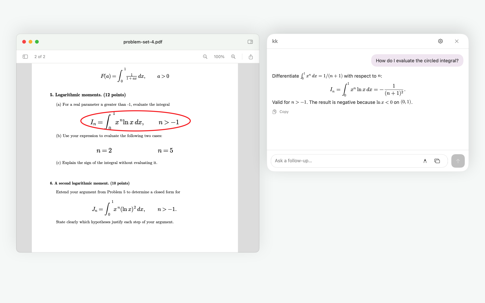
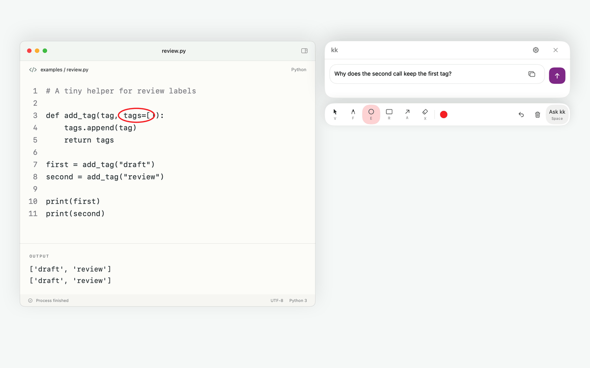
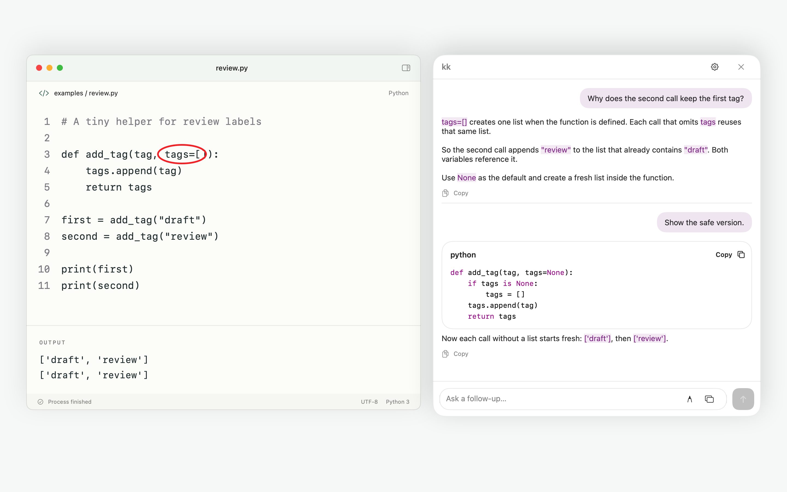
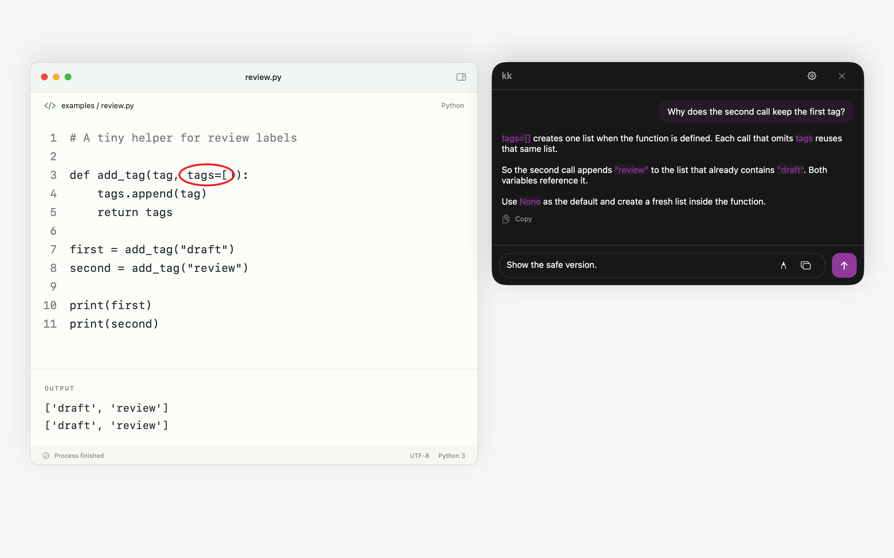
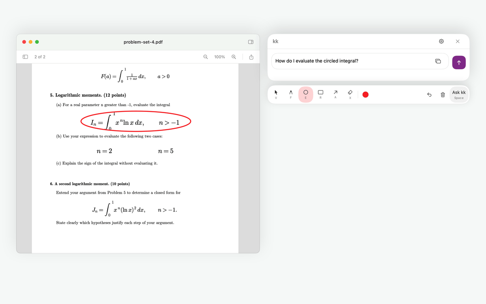
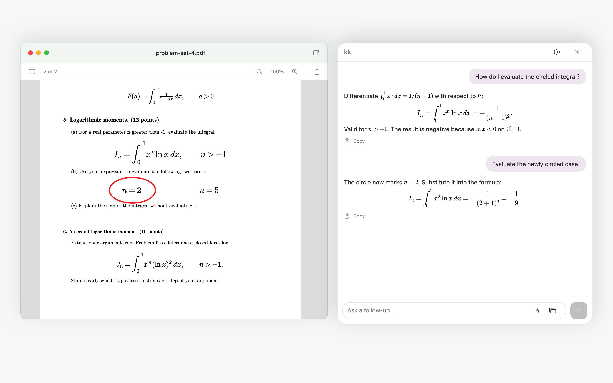

# kk

kk is a native macOS menu-bar assistant. Press **⌘⌥K**, point out what matters, and ask a question without leaving the app you're using. Bring your own OpenAI-compatible API endpoint and model.

[Download](https://github.com/imapotatoes11/kk/releases) · [Usage guide](docs/USAGE.md) · [Contributing](CONTRIBUTING.md) · [Report a bug](https://github.com/imapotatoes11/kk/issues)



## Features

- **Screen context on demand.** Attach the display under your cursor, the active window's display, or all displays. Preview or remove the attachment before sending.
- **Draw attention to the details.** Freehand marks, arrows, rectangles, and ellipses, with move, resize, eraser, and undo. Freeze the screen or work over the live desktop.
- **Attach files.** Paste, drop, or pick images (including HEIC and WebP), PDFs, and text files. Scanned PDF pages are read with on-device OCR, and vision models also see page images.
- **Follow-up conversations.** Ask another question with fresh screen context. Draft while an answer streams, stop generation, and copy answers or a Markdown transcript.
- **Readable answers.** Markdown, code blocks, tables, and LaTeX math in a resizable popup.
- **Find a quiet spot.** Optionally move chat to the largest blank area on open and send, with width and height adjusted to fit.
- **Your setup.** OpenAI-compatible cloud or local endpoints, customizable shortcuts, light and dark appearance, and optional launch at login.

<details>
<summary>See the flow: annotate, ask, follow up</summary>



The animation cycles through staged native UI renders. It is not a recording of a live model session.





</details>

<details>
<summary>Math: LaTeX answers and updated annotations</summary>



The annotation changes between turns, and the follow-up attaches the updated screen. Both GIFs advance every two seconds and use sample responses.



</details>

## Install

Requires **macOS 15 or later**. Prebuilt downloads are for **Apple Silicon (arm64)**.

1. Download the DMG from [Releases](https://github.com/imapotatoes11/kk/releases).
2. Open it and drag **kk.app** to **Applications**. A standalone app ZIP and SHA-256 checksums are also available.
3. Launch kk and follow setup. The app lives in your menu bar.

**The current release is ad-hoc signed and not notarized.** macOS may block its first launch. See the selected release's notes for installation guidance, or [build from source](#build-from-source).

## Get started

1. Open **Settings → Connection** from the menu bar or popup gear.
2. Enter your API base URL, model ID, and API key. Use a vision-capable model for screen questions; keys are optional for endpoints that don't require authentication.
3. Grant **Screen Recording** access when you want screen context. Text-only questions work without it.
4. Press **⌘⌥K**, optionally annotate the screen or paste or drop files, type a question, and press **Return**.
5. Ask a follow-up in the same popup. Each turn can attach its own screen image; earlier questions, answers, and attached images remain part of the conversation.

The base URL defaults to `https://api.openai.com/v1`. kk uses the streaming Chat Completions API. Set the model ID to one your provider supports. API usage is billed by your provider, where applicable.

| Action | Default shortcut |
| --- | --- |
| Open kk / focus an existing chat | ⌘⌥K |
| Send / new line | Return / Shift+Return |
| Attach a copied file, screenshot, or image | ⌘V |
| Return to drawing from the question field | Double-tap Shift |
| Pointer / freehand / ellipse / rectangle / arrow / eraser | V / F / E / R / A / X |
| Focus the question from the drawing canvas | Space |
| Close popup or screen preview | Escape |
| Open settings | ⌘, |

Tool keys apply while the drawing canvas has focus. Change them in **Settings → Annotations**, and change the global shortcut in **Settings → Shortcuts**. See the [usage guide](docs/USAGE.md) for capture modes, copying, customization, and troubleshooting.

## Privacy

- Questions, conversation context, attached screenshots, and attached files go **directly to your configured endpoint**. Your provider's retention policy applies.
- Screenshots, attachments, and conversations stay in app memory; kk does not save a chat history, screenshot library, or copies of your files. Closing the chat clears that session.
- PDF text extraction and OCR run on your Mac.
- API keys are stored in **macOS Keychain**. Connection and appearance preferences are saved locally.
- kk has no analytics or kk-hosted inference service. Copy actions put the selected answer or transcript on your clipboard.

Screen capture includes the visible desktop on the selected displays, not just the app you're asking about. Check the preview for sensitive content before sending. kk and its annotation toolbar are excluded; your drawn marks are included.

## Build from source

Use Xcode with Swift 6 support and the macOS SDK required by the source. Development currently uses **Xcode 27.2**; the deployment target remains macOS 15.

```sh
git clone https://github.com/imapotatoes11/kk.git
cd kk
open kk.xcodeproj
```

Select the **kk** scheme and run. Xcode resolves dependencies through Swift Package Manager. Use the Xcode app target for the runnable app bundle, which includes the icon, menu-bar configuration, and permission descriptions.

Run the test suite:

```sh
swift test
```

The native UI tests require a logged-in macOS desktop session. They use fixture responses; passing them does not verify a live provider, physical multi-display setup, or the complete macOS permission flow.

Build and packaging details are in [CONTRIBUTING.md](CONTRIBUTING.md).

## Contributing

[Issues](https://github.com/imapotatoes11/kk/issues) and pull requests are welcome. Include reproduction steps for bugs and discuss larger changes before implementing them. Read the [contributing guide](CONTRIBUTING.md) for setup, validation, and screenshot guidance.

Built with [KeyboardShortcuts](https://github.com/sindresorhus/KeyboardShortcuts) and [MarkdownView](https://github.com/LiYanan2004/MarkdownView).

## License

Licensed under the [GNU General Public License v3.0](LICENSE) (`GPL-3.0-only`).
